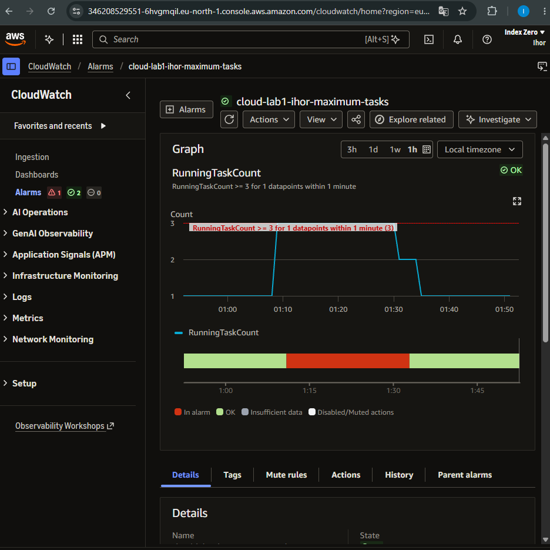
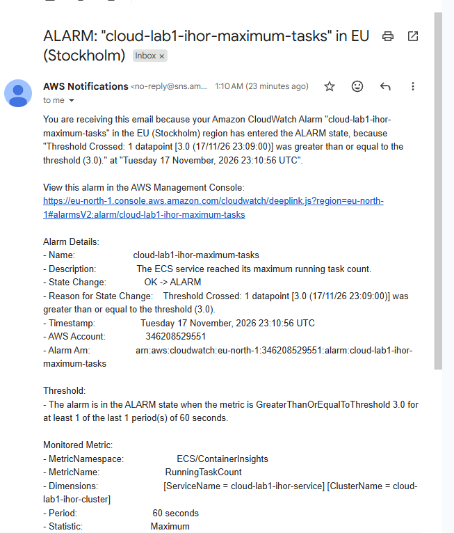
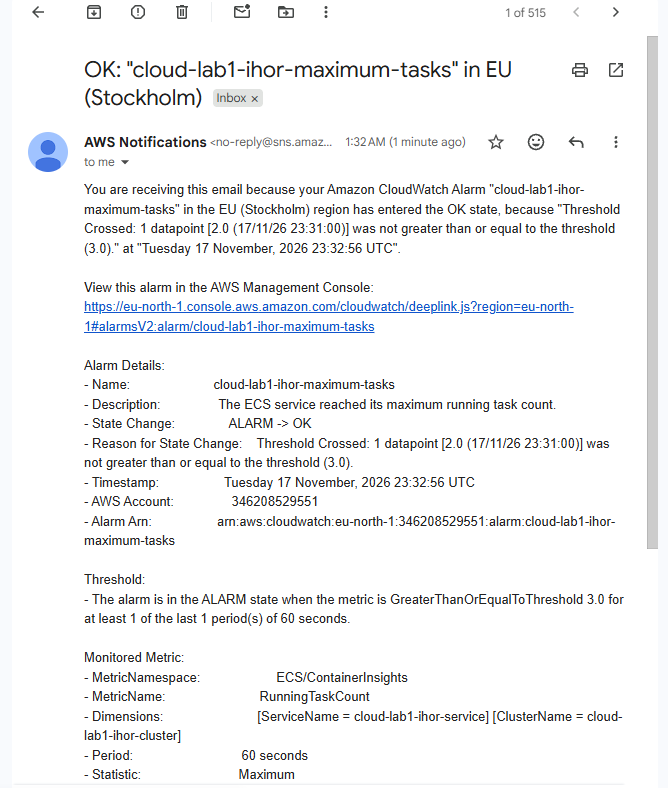
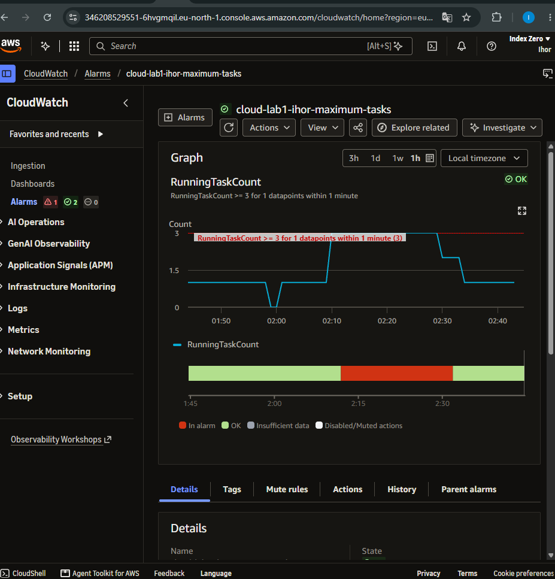
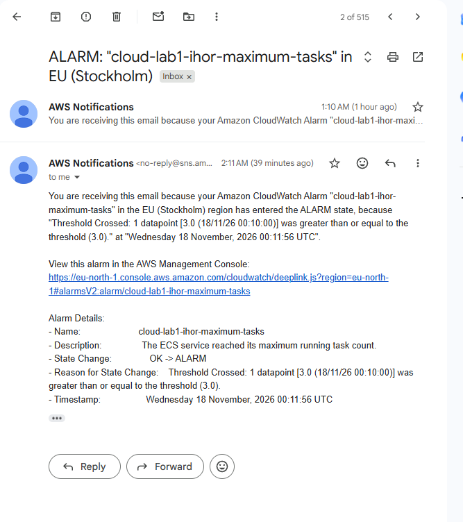
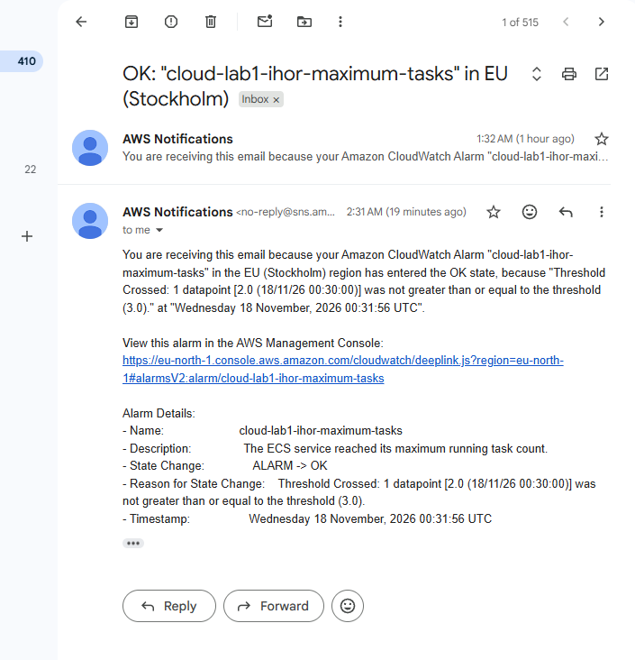
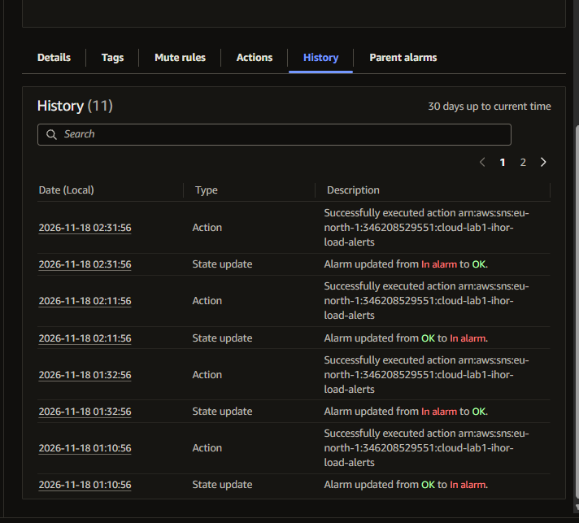

# Сповіщення

## Правило CloudWatch

| Параметр | Значення |
|---|---|
| Правило | `cloud-lab1-ihor-maximum-tasks` |
| Метрика ECS/ContainerInsights | `RunningTaskCount` |
| Статистика | Максимум за 60 секунд |
| ALARM | 3 або більше запущених задач |
| OK | Менше ніж 3 задачі |
| Пошта | Обидва переходи через SNS `cloud-lab1-ihor-load-alerts` |

Три задачі — верхня межа масштабування сервісу. У Terraform переходи ALARM і OK задано через `alarm_actions` і `ok_actions`.

## Спрацювання

18.11.2026, київський час (UTC+2).

| Подія | Без кешу | З кешем |
|---|---|---|
| Початок сталої фази | 01:02:55 | 02:01:59 |
| Стан ALARM | 01:10:56 | 02:11:56 |
| Лист ALARM | 01:10 | 02:11 |
| Стан OK | 01:32:56 | 02:31:56 |
| Лист OK | 01:32 | 02:31 |
| Затримка ALARM | ≈8 хв | ≈9 хв 57 с |

Затримку пораховано від початку сталої фази до зміни стану в CloudWatch. Пошта показує час до хвилини. Для сигналу про досягнення межі у три задачі затримка прийнятна. Для швидкого виявлення повільних відповідей варто відстежувати p95 окремо.

## Скриншоти

### Без кешу

### З кешем

### Історія

