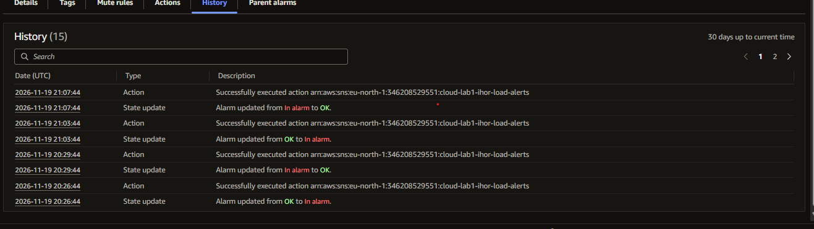

# Сповіщення

| Параметр | Значення |
| --- | --- |
| Алерт | `cloud-lab1-ihor-cpu-high` |
| Метрика | Середній `CPUUtilization` сервісу ECS за 1 хв |
| Умова | CPU вище 70% дві хвилини поспіль |
| SNS | `cloud-lab1-ihor-load-alerts`, листи при `ALARM` та `OK` |

Ціль масштабування нижча за поріг алерта, тому ECS може почати реагувати раніше. Два виміри поспіль відсікають короткі піки.

## Фінальні прогони

| Подія (UTC) | Без кешу | З Redis |
| --- | ---: | ---: |
| `ALARM` | 20:26:44 | 21:03:44 |
| `OK` | 20:29:44 | 21:07:44 |
| Кінець HTTP-навантаження | 20:29:51 | 21:07:39 |
| Від початку сталої фази до `ALARM` | 3 хв 53 с | 3 хв 5 с |
| Доставлено за метрикою SNS | 2 | 2 |

Обидва `ALARM` спрацювали під навантаженням. У прогоні з Redis стан `OK` повернувся через 5 с після останніх запитів, поки k6 ще спостерігав за сервісом.

[Метрики SNS без кешу](evidence/cloudwatch-redis-off.json) · [Метрики SNS з Redis](evidence/cloudwatch-redis-on.json)

## Листи з попереднього тесту

| Прогін 18.11.2026 | CloudWatch | ALARM | OK |
| --- | --- | --- | --- |
| Без кешу | [Графік](public/no_cache/alarm_console.png) | [Лист](public/no_cache/alarm_msg.png) | [Лист](public/no_cache/ok_msg.png) |
| З процесним кешем | [Графік](public/cache/alarm_console.png) | [Лист](public/cache/alarm_msg.png) | [Лист](public/cache/ok_msg.png) |

[Історія попереднього алерта](public/alarm_history.png)
