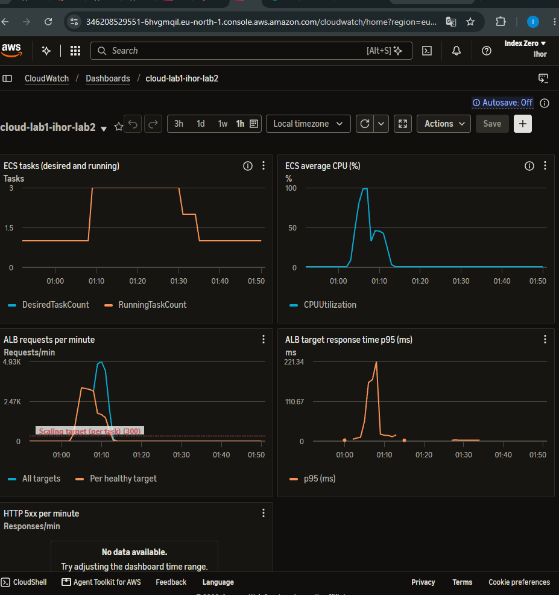
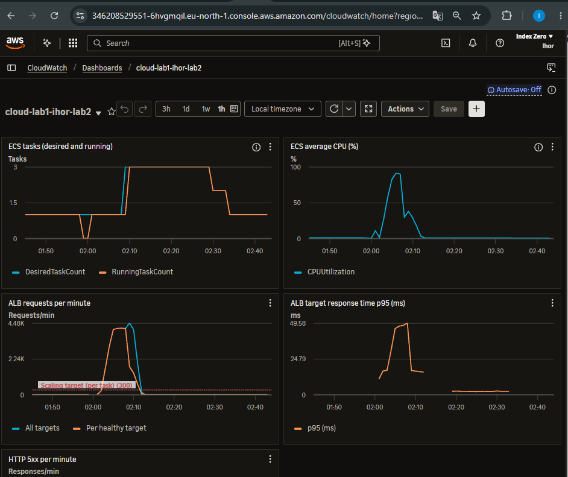

# Автоматичне масштабування

## Політика ECS

Сервіс `cloud-lab1-ihor-service` працює на ECS Fargate. Кількістю задач керує політика Target Tracking у `infra/autoscaling.tf`.

| Параметр | Значення |
|---|---|
| Мінімум | 1 задача |
| Максимум | 3 задачі |
| Метрика | `ALBRequestCountPerTarget` |
| Ціль | 300 запитів/хв на здорову задачу |
| Cooldown на збільшення | 60 с |
| Cooldown на зменшення | 180 с |

Ціль 300 запитів/хв дорівнює приблизно 5 запитам/с на задачу. Ця метрика враховує запити й тоді, коли API очікує відповіді від PostgreSQL. Після перевищення порогу ECS потрібен час, щоб запустити контейнер і пройти перевірку ALB. Перед зменшенням AWS оцінює стійкість спаду. Cooldown стримує повторні дії. За значення 0 кількість задач при нерівному трафіку може коливатися частіше.

## Панель CloudWatch

| Графік | Метрика | За 60 с |
|---|---|---|
| Задачі ECS | `DesiredTaskCount`, `RunningTaskCount` | Максимум |
| CPU | `CPUUtilization` | Середнє, % |
| Запити ALB | `RequestCount`, `RequestCountPerTarget` | Сума за хв |
| Латентність ALB | `TargetResponseTime` | p95, мс |
| Відповіді 5xx | `HTTPCode_Target_5XX_Count`, `HTTPCode_ELB_5XX_Count` | Сума за хв |

Ціль 300 відповідає лінії **Per healthy target**. Панель 5xx не мала точок у показаному інтервалі, а k6 зафіксував 0% помилок в обох прогонах.

## Прогони

18.11.2026, київський час (UTC+2). Час із графіка позначено як приблизний.

| Подія | Без кешу | З кешем |
|---|---|---|
| Старт тесту | 00:59:55 | 01:58:59 |
| Стала фаза | 01:02:55 | 02:01:59 |
| Вище 300 запитів/хв на задачу | ≈01:03 | ≈02:03 |
| На метриці 3 задачі | 01:09 | 02:10 |
| Знову 1 задача | ≈01:35 | ≈02:34 |

В обох прогонах ECS змінив кількість задач за схемою **1 → 3 → 2 → 1**.

## Скриншоти

### Без кешу

### З кешем

