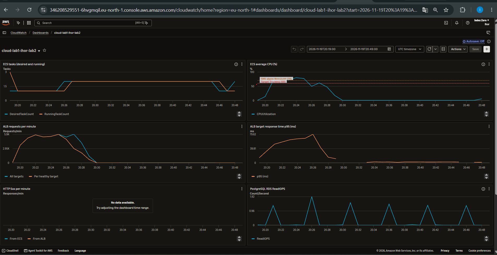
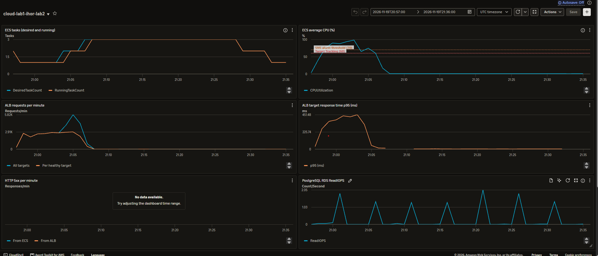
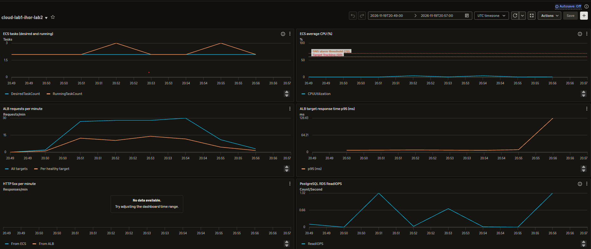

# Автоматичне масштабування

| Параметр | Значення |
| --- | --- |
| Політика | Target Tracking за середнім CPU сервісу ECS |
| Ціль | 60% |
| Кількість задач | 1–3 |
| Cooldown | 60 с на збільшення, 180 с на зменшення |
| Межі під час деплою | 100% мінімум здорових задач, 150% максимум |

У першій версії ціль 300 запитів/хв швидко піднімала ECS до максимуму. Ціль 60% обрали, щоб лишити запас CPU на час запуску нової задачі. [Конфігурація Terraform](../infra/autoscaling.tf) · [Вибір навантаження](LOADTEST.md#вибір-n)

## Фінальні прогони

| Подія (UTC) | Без кешу | З Redis |
| --- | ---: | ---: |
| Початок тесту | 20:19:51 | 20:57:39 |
| Початок сталої фази | 20:22:51 | 21:00:39 |
| Перший інтервал CPU > 60% | 20:21:00 | 20:59:00 |
| ECS отримав команду додати задачу | 20:26:02 | 21:04:02 |
| Друга задача готова | 20:27:12 | 21:05:08 |
| Початок спаду | 20:27:51 | 21:05:39 |
| Кінець HTTP-навантаження | 20:29:51 | 21:07:39 |
| Знову одна задача | 20:46:45 | 21:32:40 |

Друга задача була готова до спаду в обох тестах. Після підвищення CPU AWS збирає метрики, запускає задачу й чекає перевірки ALB. У цих тестах для зменшення потрібно було 15 хвилинних точок нижче 54%. З Redis AWS додатково відклала зменшення через ризик повторного масштабування (`AutoScalingAnticipatedFlapping`).

На початку графіка без кешу видно завершення калібрування. Фази фінальних тестів наведено в таблиці. На панелі CloudWatch є кількість задач, CPU, запити ALB, p95, HTTP 5xx і метрики RDS.

## Оновлення ECS

Перед оновленням підняли мінімум до двох задач і перевірили, що обидві цілі ALB здорові. Під час деплою до `app:5` усі 125 перевірок `/health` пройшли. [Здорові цілі ALB](public/aws/healthy-targets-before-deploy.png) · [Деплой у консолі ECS](public/aws/rolling-deployment.png) · [Результати перевірок](evidence/redis-rollout-health.json)

