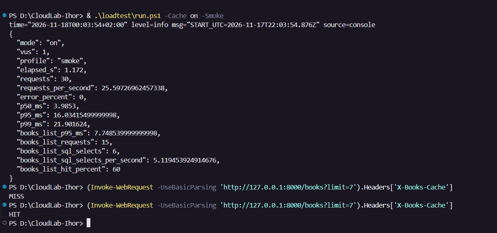

# Кешування списку книжок

## Налаштування

| Параметр | Значення |
|---|---|
| Схема | Cache-aside у пам’яті процесу |
| Маршрут | `GET /books` |
| Ключ | `limit` |
| TTL | 45 с |
| Місткість | 16 ключів |
| Перемикач AWS | `books_cache_enabled` |

При промаху API читає PostgreSQL і зберігає список у кеші. Після створення, оновлення або видалення книжки задача очищає свій кеш. Інша задача ECS може віддавати старий список до спливу TTL. Цей час можна скоротити меншим TTL або спільним кешем з інвалідацією після запису.

## Результати AWS

### Швидкість API

| Метрика | Без кешу | З кешем |
|---|---|---|
| p95 усіх запитів, мс | 116,58 | 92,17 |
| p95 списку, мс | 123,17 | 91,47 |
| Запити/с | 52,07 | 53,26 |

### Читання списку

| Метрика | Без кешу | З кешем |
|---|---|---|
| Успішні читання | 15 610 | 15 975 |
| З кешу | 0 | 11 217 |
| SQL SELECT | 15 610 | 4 758 |
| SQL SELECT/с | 26,04 | 7,93 |
| Влучання | 0% | 70,22% |

BYPASS і MISS відповідають одному SELECT для списку, HIT — читанню з пам’яті. З кешем p95 списку знизився на **25,7%**, кількість SELECT — на **69,5%**.

## Локальна перевірка

| Метрика | Без кешу | З кешем |
|---|---|---|
| Запити | 30 | 30 |
| Помилки | 0% | 0% |
| Читання списку | 15 | 15 |
| SQL SELECT для списку | 15 | 6 |
| Влучання | 0% | 60% |

Два послідовні читання з `limit=7` повернули MISS і HIT.

[JSON без кешу](evidence/k6-smoke-off.json) · [JSON з кешем](evidence/k6-smoke-on.json)
