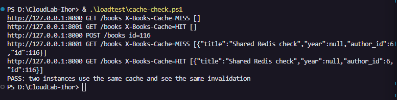
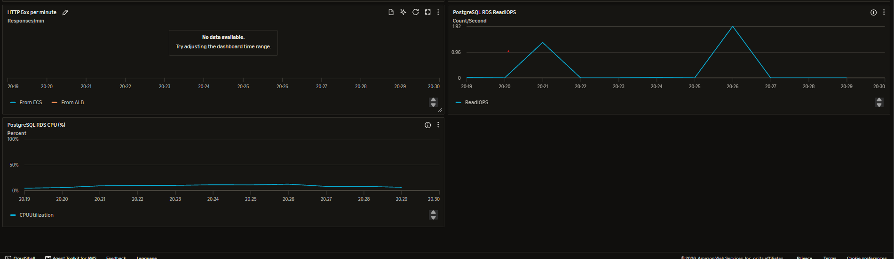
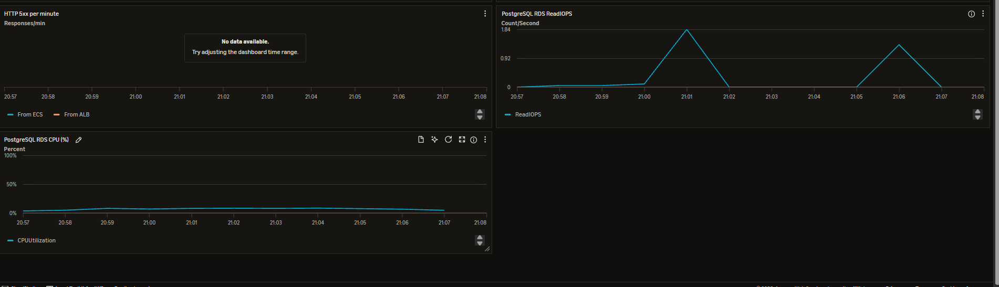

# Кешування читання

| Параметр | Поведінка |
| --- | --- |
| Ключ | Покоління списку, `author_id` і `limit` |
| TTL | 45 с |
| `HIT` | Відповідь із Redis |
| `MISS` | Читання PostgreSQL і заповнення кешу |
| `BYPASS` | Читання з БД, коли кеш вимкнений або Redis недоступний |

Після запису змінюється спільне покоління списку, тому нові читання з усіх задач бачать оновлення. Якщо під час запису Redis недоступний, після його відновлення старий список може лишатися до кінця TTL.

Локально той самий Redis дав `MISS` першому екземпляру і `HIT` другому. Після запису другий одразу прочитав нову книгу.

## Результати 12 VU

| Метрика | Без кешу | З Redis |
| --- | ---: | ---: |
| p95 усіх запитів, мс | 202,72 | 447,75 |
| p95 списку книг, мс | 214,09 | 501,72 |
| Запитів/с | 79,84 | 51,44 |
| Влучання, % | 0,00 | 59,25 |
| Успішні читання списку | 23 985 | 15 425 |
| Оцінка читань списку з БД | 23 985 | 6 286 |
| Середній CPU RDS, % | 9,354 | 7,457 |
| Середній ReadIOPS RDS | 0,361 | 0,376 |

З Redis база обробила менше читань списку, а відповіді API стали повільнішими. CPU і ReadIOPS взято з CloudWatch за дев’ять повних хвилин кожного тесту. Влучання й читання списку пораховано за `X-Books-Cache`.

[Деталі ElastiCache в консолі](public/aws/elasticache.png) · [RDS без кешу](evidence/rds-redis-off.json) · [RDS з Redis](evidence/rds-redis-on.json)

