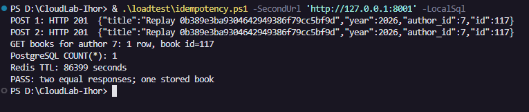

# Ідемпотентність запису

У `POST /books` можна передати `Idempotency-Key` до 128 символів. Redis зберігає результат на 24 години. PostgreSQL зберігає книгу та результат одним комітом і блокує паралельні запити з однаковим ключем. Якщо Redis недоступний, відповідь відтворюється з бази.

| Запит | Результат |
| --- | --- |
| Новий ключ | `201`, створюється книга |
| Той самий ключ і тіло | `201` з тим самим ID |
| Той самий ключ, інше тіло | `409 Conflict` |
| Без ключа | Звичайне створення книги |


## Перевірка

```powershell
$Url = terraform -chdir=infra output -raw app_url
& .\loadtest\idempotency.ps1 -Url $Url
```



