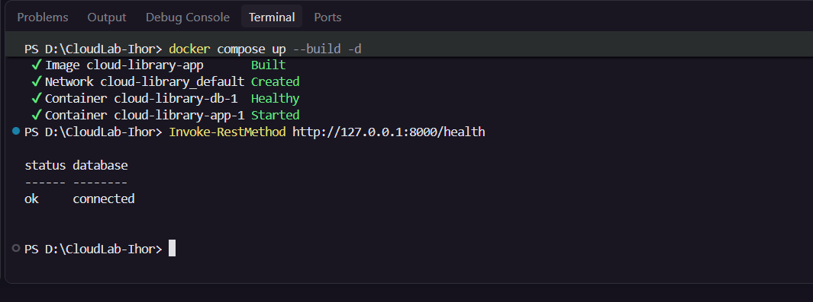

# Навантажувальне тестування

## Сценарій k6

| Запит | За цикл | Дія |
|---|---|---|
| `POST /books` | 1 | Створення книжки |
| `GET /books?limit=...` | 5 | Три списки по 100 і два по 50 |
| `GET /books/{id}` | 3 | Дві підготовлені книжки й нова |
| `GET /authors/{id}` | 1 | Читання автора |

Підготовка даних відбувається до вимірювань. Пауза між циклами 0,5 с.

| Фаза | Час | Користувачі |
|---|---|---|
| Наростання | 3 хв | 0 → 8 |
| Стала фаза | 5 хв | 8 |
| Спад | 2 хв | 8 → 0 |

## Результати AWS

| Метрика | Без кешу | З кешем |
|---|---|---|
| Час, с | 599,56 | 599,84 |
| Запити | 31 220 | 31 950 |
| Запити/с | 52,07 | 53,26 |
| Помилки | 0% | 0% |

| Латентність, мс | Без кешу | З кешем |
|---|---|---|
| p50 | 47,14 | 57,16 |
| p95 | 116,58 | 92,17 |
| p99 | 292,26 | 104,92 |

У прогоні з кешем p95 і p99 зменшилися, а p50 зріс. Після обох прогонів ECS повернувся до однієї задачі.

[JSON без кешу](evidence/k6-off.json) · [JSON з кешем](evidence/k6-on.json)

## Локальна перевірка

