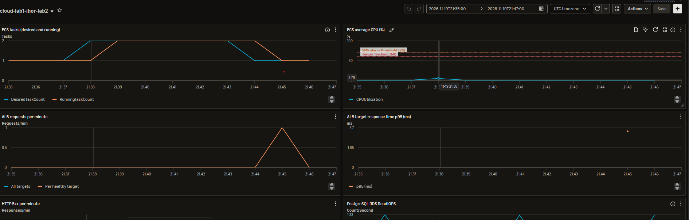

# Масштабування за розкладом

| Дія | Europe/Kyiv | Cron | Мінімум | Максимум |
| --- | --- | --- | ---: | ---: |
| День | 07:00 | `cron(0 7 * * ? *)` | 2 | 3 |
| Ніч | 23:00 | `cron(0 23 * * ? *)` | 1 | 3 |

Розклад вмикається через `enable_scheduled_scaling`. Він змінює мінімум задач, а політика за CPU регулює їх кількість у цих межах.

## Перевірка в AWS

| Час (UTC) | Результат |
| --- | --- |
| 21:38:44 | Мінімум 2, працюють дві задачі |
| 21:43:44 | Мінімум змінився на 1 |
| 21:44:19 | ECS повернувся до однієї задачі |

Після тесту повернули робочий розклад 07:00 та 23:00 за Києвом. [Дані перевірки](evidence/redis-schedule.json)

## Вартість за 30 днів

Одна задача Linux/x86 у Stockholm має 0,25 vCPU і 0,5 ГіБ RAM. Година коштує `0,25 × 0,0445 + 0,5 × 0,0049 = $0,013575`. [Тарифи ECS для Stockholm](https://pricing.us-east-1.amazonaws.com/offers/v1.0/aws/AmazonECS/current/eu-north-1/index.json)

| Варіант | Задачо-години | Fargate |
| --- | ---: | ---: |
| Постійно 2 задачі | 1 440 | $19,55 |
| 2 вдень, 1 вночі | 1 200 | $16,29 |
| Постійно 1 задача | 720 | $9,77 |

Економія проти двох постійних задач становить **$3,26 на місяць** за базові задачі Fargate. 
